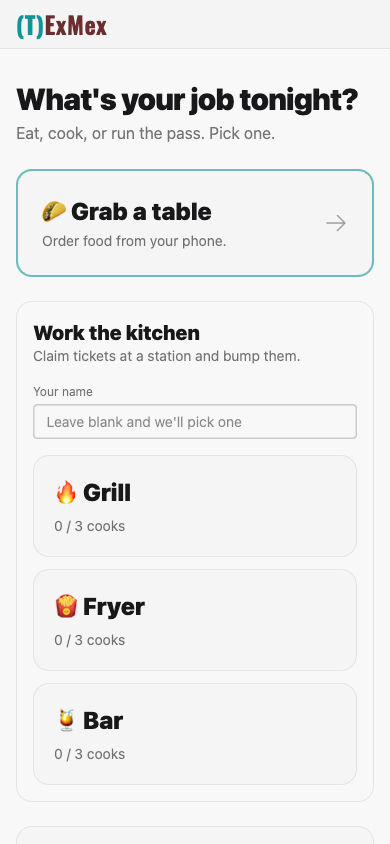
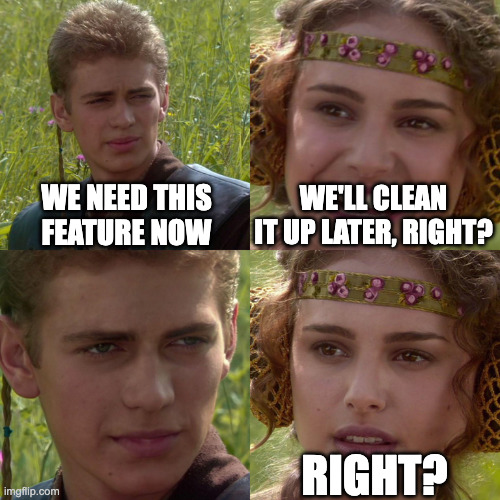
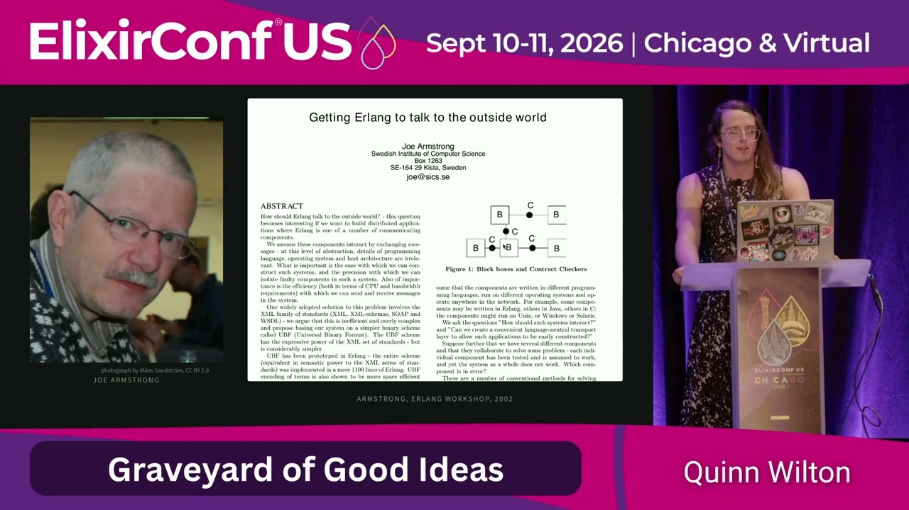
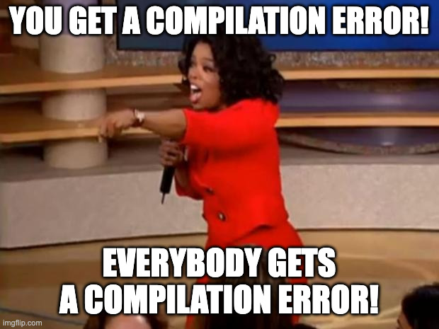

<!-- _class: title statement -->

# Preventing Pub/Sub <span class="swap"><span class="old">Spaghetti</span><span class="new" data-marpit-fragment>Nachos</span></span> in Event-Driven Systems

Brian Meeker

<!--
Good morning everybody. Really excited to be here at ExMex. We're going to be talking about pub/sub today. Before we get started, I must admit that I made a terrible mistake when submitting this talk.

<click> In honor of ExMex, it clearly should have been pub/sub nachos. On a plate of good nachos, you can't pick up a chip without disturbing at least three others and getting a random assortment of toppings in each bite.
-->

---

<div class="columns">
<div>

# Brian Meeker

Engineering Manager, GetThru

<span class="accent">@brianmeeker.bsky.social</span>

</div>
<div class="center">


<span class="caption">github.com/CuriousCurmudgeon/ex_mex_2026_talk</span>

</div>
</div>

<!--
My name is Brian Meeker. I've traveled here today from the far off lands of Indiana. This is my first time stepping foot in Texas outside of an airport.

I spend my work hours as the engineering manager at GetThru. Because of the upheaval in our industry over the past year, I still get to write code. Well, a robot writes code for me, but I still get to tell myself that I'm writing code.

You can mostly find me these days on Bluesky. These slides are available on GitHub. That same QR code will be up at end as well. You don't have to rush to get it right now.

Even though this is a single track conference, I still want to encourage everybody to take care of yourselves. If the content of this talk just isn't working for you, go make better use of your time. I won't be offended. That goes for everybody watching on YouTube later too. The internet is vast and full of wonders. I can't compete with that.
-->

---

<div class="columns">
<div class="center">


## texmex.fly.dev

</div>
<div class="center">



</div>
</div>

<!--
Today we're going to talk about pub/sub. We'll talk about what we get out of the box with Phoenix Pub/Sub. We'll talk about the kinds of messes you can make with this. And then we'll talk about how we can layer compile-time guarantees on top of pub/sub to help out both human and LLM-assisted development. Because, at least for the current time being, most things you do to make development better for humans also happen to make it better for robots as well.

All code examples today are pulled from the demo app in the git repo. We're at ExMex, so what better way to walk through our examples than with a demo app for a Tex Mex restaurant. You can find it at https://texmex.fly.dev/

Feel free to play around with this or pull down the code. It's all vibes and it makes good use of pub/sub to broadcast events as orders are put in and they are handled by the back of house. You can place orders or get a job.
-->

---

<!-- _class: statement -->

# Action at a distance

<!--
Who here has worked on a heavily evented system where it was very difficult to track all the action at a distance?

GetThru's code base recently passed the 10 year mark. I've worked on older code bases than this. I've been doing this a long time. But this is one of the older ones. And like most older code bases, a lot of people have worked on it over the years. Historically, we work in the election industry, so as election time approaches, there is pressure to rapidly address issues and add new features for important clients.
-->

---



<!--
And then the promised time to clean it up later would rarely materialize. This combination of many hands and time pressure does not lead to great solutions. Our pub/sub usage had grown haphazardly this entire time. It had never been seriously refactored.

This meant that nothing was centralized. Every module directly used the functions exposed in the default Pub/Sub module you get with a new Phoenix app. In many ways, this is similar to the context module problem. People see what the generator gives them out of the box and just assume that is how it needs to stay. It's not.

Are there any old Rails devs in the room? Or maybe veterans of other frameworks that are very opinionated and magical? Have you ever worked on teams where most of them are afraid to change the structure of anything that came out of the box? Rails apps that have no concept of code living somewhere other than a model, view, or controller? I do not have a lot of professional Rails experience and even I have seen this.
-->

---

<!-- _class: statement -->

# Be the change you want to see

<!--
It doesn't have to be that way though! Phoenix is not that magical. That pub/sub module that got generated? It's not magic. You can add functions to it. You can move it wherever you want!

For example, I think that it's silly to have the generated pub/sub module be in the web project for a new app. Now my business layer needs to take a dependency on something in the web layer. That's wrong. Move it. Module names and directories have no meaning in Elixir. Move them where ever you want!
-->

---

<!-- _class: statement -->

# Code generators are merely a suggestion

<!--
Code generators are merely a suggestion for how to get started. You don't have to stick with just that. Constraints are great when getting started. I'm a firm believer in the aphorism that constraints breed creativity. Generators help with the blank page problem. But after that they are merely a suggestion.
-->

---

<!-- _class: statement -->

# What pain points were we seeing?

<!--
Circling back around though, what was GetThru's problem? What pain points were we seeing?

Because every module was responsible for subscribing and broadcasting directly, there was no reasonable way to find what our pub/sub API was. There was no way to easily see what the name of a topic was. No way to keep topic naming consistent. No way to keep event naming on those topics consistent. No way to keep the shape of the payloads for those events consistent.

And, at another level, we hadn't defined what our expected behavior was for subscribers. If a process subscribed to a topic, did it have to have an explicit handler for every possible event? What should happen if unexpected events are sent? Is it ok to have a catch-all handler? If so, what should the behavior of that handler be? Should it log a warning? Should it raise and crash the process?

Nobody knew. Nobody had decided what the behavior should be, so it was a combination of all of those. There was no consistency.
-->

---

<!-- _class: labeled small-code -->

## No Helper Module

<p class="where">Cantina.Orders · messy-pubsub</p>

```elixir {4-8|}
for ticket <- tickets do
  :ok = Kitchen.open(ticket)

  Phoenix.PubSub.broadcast(
    Cantina.PubSub,
    "stations:#{ticket.station}",
    {:fired, ticket}
  )
end

Phoenix.PubSub.broadcast(
  Cantina.PubSub,
  "tables:#{table_id}",
  {:placed, order_id, line_items}
)
```

<!--
Now, I can't show you production code from our app, but I do have examples from TexMex showing this pattern. They are in the messy-pubsub branch.

Going down that path with our TexMex app, you can see how we broadcast tickets to kitchen stations. An order comes in and each line item is sent to appropriate kitchen station. We just call broadcast directly.
-->

---

<!-- _class: labeled -->

## No Helper Module

<p class="where">CantinaWeb.StationLive · messy-pubsub</p>

```elixir {2|}
if connected?(socket) do
  Phoenix.PubSub.subscribe(Cantina.PubSub, "stations:#{station}")
  Phoenix.PubSub.subscribe(Cantina.PubSub, "menu")
  # ...
end
```

<!--
Each kitchen station then subscribes to the topic for their station. Once again, directly calling the Phoenix PubSub API.
-->

---

<!-- _class: labeled small-code -->

## No Helper Module

<p class="where">CantinaWeb.StationLive · messy-pubsub</p>


```elixir {1|}
def handle_info({:fired, ticket}, socket), do: {:noreply, put_ticket(socket, ticket)}

def handle_info({:claimed, id, name}, socket) do
  {:noreply, update_ticket(socket, id, &%{&1 | claimed_by: name})}
end

def handle_info({:released, id}, socket),
  do: {:noreply, update_ticket(socket, id, &%{&1 | claimed_by: nil})}

def handle_info(%{event: "bumped", ticket_id: id}, socket) do
  {:noreply, drop_ticket(socket, id)}
end

def handle_info({:special_added, item, _note}, socket) do
  # ...
end
```

<!--
And then we handle those events with handle_info. All of these are kitchen station events. You can see the :fired event we broadcast a couple slides ago here.

This is about the most basic way to do pub/sub in an Elixir app. Just call functions on Phoenix Pub/Sub. And this can be fine! If your app is small, then you don't really need any more complexity. But when your app is larger, then this becomes unwieldy. It becomes difficult to keep track of your API for pub/sub. What topics does your app use? What is your preferred naming pattern for topics? What conventions do you want for the shape of payloads? What about the weight of those payloads? Should you pass around only ids or should you pass around structs with more info?
-->

---

<!-- _class: statement -->

# Start centralizing

<!--
Answering those questions is harder unless you start centralizing your management of pub/sub

The first thing we did to start addressing these issues was to start centralizing pub/sub subscribe and broadcast functions in a single module. This started making it easier to understand what pub/sub the app was even doing.

We started doing this work in 2024. These days it would be pretty easy to use your LLM of choice to have one big PR that made a cross-cutting change across the app to centralize all the subscribe and broadcast functions. That wasn't the case in 2024.

Like us, when you start to do this you will probably start finding the source of various bugs. The worst one that we found so far was three different rarely used live views that all broadcast the same event on the same topic, but all three of them sent a differently shaped payload. This was difficult to spot before. It was extremely rare for more than one of these to be open at the same time and see this uncommon event be published. Because of that, it was never a priority to dig into our error tracker and figure it out.
-->

---

<!-- _class: labeled -->

## Creating Helper Modules

<p class="where">Cantina.Orders · organized-pubsub</p>

```elixir {3|}
for ticket <- tickets do
  :ok = Kitchen.open(ticket)
  Cantina.PubSub.broadcast_fired(ticket)
end

Cantina.PubSub.broadcast_placed(table_id, order_id, line_items)
```

<!--
So we centralized. Here's the same example from our Tex Mex sample app with this approach. We can see that we're just calling functions still, but it's functions that we've defined in the Cantina.PubSub module.
-->

---

<!-- _class: labeled small-code -->

## Creating Helper Modules

<p class="where">CantinaWeb.StationLive · organized-pubsub</p>


```elixir {2|}
if connected?(socket) do
  :ok = Cantina.PubSub.subscribe_station(station)
  :ok = Cantina.PubSub.subscribe_menu()
  # ...
end
```

<!--
And here is how we subscribe to those topics then.
-->

---

<!-- _class: labeled small-code -->

## Creating Helper Modules

<p class="where">CantinaWeb.StationLive · organized-pubsub</p>


```elixir {1-2|}
def handle_info({:fired, %{ticket: ticket}}, socket),
  do: {:noreply, put_ticket(socket, ticket)}

def handle_info({:claimed, %{ticket_id: id, cook_name: name}}, socket),
  do: {:noreply, update_ticket(socket, id, &%{&1 | claimed_by: name})}

def handle_info({:released, %{ticket_id: id}}, socket),
  do: {:noreply, update_ticket(socket, id, &%{&1 | claimed_by: nil})}

def handle_info({:bumped, %{ticket_id: id}}, socket),
  do: {:noreply, drop_ticket(socket, id)}
```

<!--
And how we handle them. This is just standard handle_info usage for pub/sub.
-->

---

<!-- _class: labeled tiny-code -->

## Creating Helper Modules

<p class="where">Cantina.PubSub · organized-pubsub</p>


```elixir {2|5-6}
defmodule Cantina.PubSub do
  def subscribe_station(station), do: subscribe(station_topic(station))

  @doc "A new ticket reached its station."
  def broadcast_fired(%Ticket{} = ticket),
    do: broadcast(station_topic(ticket.station), {:fired, %{ticket: ticket}})

  @doc "A cook took a ticket."
  def broadcast_claimed(station, ticket_id, cook_name),
    do:
      broadcast(
        station_topic(station),
        {:claimed, %{ticket_id: ticket_id, cook_name: cook_name}}
      )

  defp station_topic(station) when is_atom(station), do: "stations:#{station}"

  defp subscribe(topic), do: Phoenix.PubSub.subscribe(@server, topic)
  defp broadcast(topic, message), do: Phoenix.PubSub.broadcast(@server, topic, message)
end
```

<!--
The helper functions themselves are straightforward. They just call broadcast and subscribe. All we've done is wrap the usage of Phoenix Pub/Sub in function calls that are a bit aware of our domain.

And they don't have to live in the PubSub module. Maybe in your app it makes more sense for them to live in various context modules. That's fine. As long as you know where they are and can easily find your topics, events, and payloads, you're making progress.

But having consistency is only half the battle here. You've made it easier to find the surface area of your pub/sub API. It won't be a big ball of mud anymore, but it might still be a plate of nachos. That is way more appetizing than a big ball of mud at least.
-->

---

<!-- _class: statement -->

# Help your robot pal 🤖

<!--
With LLM's, we started improving things more with a style guide. We have guidance for how to document functions that broadcast on topics. We have guidance for how to document a module that subscribes to topics.

The robots are really good at this kind of thing. You can have reliable mix docs that describe what functions broadcast and what modules subscribe. The robot will keep those docs up to date pretty well. The style guide is helpful for people, but great for robots.
-->

---

<!-- _class: labeled -->

## Verified Routes

<p class="where">CantinaWeb.HomeLive</p>

```elixir {8|}
def handle_event("pick", %{"station" => station}, socket) do
  name =
    case String.trim(socket.assigns.form[:name].value || "") do
      "" -> Kitchen.next_cook_name()
      name -> String.slice(name, 0, 24)
    end

  {:noreply, push_navigate(socket, to: ~p"/kitchen/#{station}?#{[name: name]}")}
end
```

<!--
This is all well and good, but we can do better. I'm a big fan of verified routes in Phoenix. Here we can see an example of one in use in a handle_event function. Users pick what kitchen station they want to work in and we push_navigate them there.

Verified routes uses the router as a DSL to build up a data structure of valid routes in our application. It gives you compile-time validation that the routes you're using are correct.

What if we did the same thing for pub/sub? Can we enforce compile-time validation that you're broadcasting and subscribing to documented topics? Can we guarantee that a module handles all events on a topic? What about the shape of the message payload? What would we need to do that?
-->

---

<!-- _class: statement -->

# verified_pubsub


<span class="caption">hex.pm/packages/verified_pubsub</span>

<!--
So I did that with a new library called verified_pubsub. This is an idea that had been percolating in the back of my mind for the past two years. The problem was that I'm a very mediocre programmer with macros. I had never tried anything this complicated. I knew I could figure it out, but I also wasn't willing to spend a bunch of evenings and weekends working on it. I have hobbies. I have kids. I enjoy programming, but I'm not the kind of guy who's interested in spending many of his nights and weekends working on these things.
-->

---

<div class="columns wide-left">
<div>



</div>
<div class="center">


</div>
</div>

<!--
But we have LLMs now. Quinn Wilton's talk at ElixirConf US this year has really stuck with me. The barrier between that idea in your head and a working implementation has never been smaller. Quinn was talking about really ambitious projects that previously would have taken hundreds or thousands of hours to implement. They may have needed an entire team all putting in those kinds of hours. LLMs have changed that calculus.

I watched her talk already knowing this was true. I had this idea for years that I had not been able to justify spending the time on. But I had vibe coded an initial version of verified_pubsub in 4-5 hours a few Sundays before ElixirConf while doing other work around my house.
-->

---

<!-- _class: statement -->

# Be ambitious. You can build it  

<!--
If you take nothing else away from this talk, it should be this. Be ambitious. If your boss is not encouraging you to be ambitious, if your company is not giving you space to be ambitious, they are categorically wrong. If it's a technical problem and you can articulate what properties you want the system or library to have, the robot can probably quickly build it for you. If you can't articulate those things, you can explore the design space more quickly.

As I walk through this library, let your mind wander. You may not like my solution to this problem. If you can articulate what you don't like about it, you can quickly generate your own solution. Maybe you don't like my API. Maybe you don't like the dependency on Spark. Whatever it is, you can talk to me. And if my spongey brain matter disagrees with your spongey brain matter, it's trivial to fork my version or build your own.
-->

---

<!-- _class: labeled -->

## Verified Routes

<p class="where">CantinaWeb.Router</p>

```elixir
scope "/", CantinaWeb do
  pipe_through :browser

  live "/", HomeLive

  live "/t/:table_id", DinerLive
  live "/kitchen/:station", StationLive
  live "/expo", ExpoLive
  live "/board", BoardLive
end
```

<!--
Verified routes derives valid routes through the router module. Let's look at what we can do for verified_pubsub
-->

---

<!-- _class: labeled tiny-code -->

## Manifests

<p class="where">Cantina.Manifest</p>


```elixir {4|7,12,17|8-9,14,18}
defmodule Cantina.Manifest do
  use VerifiedPubSub.Manifest, pubsub: Cantina.PubSub

  topic :table, ["tables", :table_id] do
    description "The status of the orders of one table."

    message :placed do
      field :order_id, :string
      field :line_items, {:list, Cantina.LineItem}
    end

    message :ready do
      description "The kitchen finished each ticket of the order."
      field :order_id, :string
    end

    message :served do
      field :order_id, :string
    end
  end
end
```

<!--
Phoenix PubSub has no equivalent module to organize topics and messages, so we have to make our own. Enter the manifest module

Manifest here means something like a shipping manifest. A shipping manifest lists everything and everybody on a ship. Here, we want to list all the topics, the messages on those topics, and the shape of the payload for those messages. Not quite a 1:1 mapping on to a shipping manifest, but the name works well enough.

This DSL uses Spark. It gives us the equivalent of a router module for pub/sub. This lets us gather metadata for what every topic and message looks like, including the shape of the payload for each message.
-->

---

<!-- _class: labeled -->

## Manifests

<p class="where">Cantina.Manifest</p>

```elixir
topic :table, ["tables", :table_id]
```

```
"tables:42"
"tables:7"
```

<!--
Looking at the topic we have here, the first atom is a unique name for your topic. This is not the shape of the topic on the wire. That part is defined by the list. So, the topic on the wire ends up becoming something "tables:42", "tables:7", etc.
-->

---

<!-- _class: labeled small-code -->

## Broadcasting

<p class="where">Cantina.Orders</p>

```elixir {2|8|11-14}
defmodule Cantina.Orders do
  use VerifiedPubSub, manifest: Cantina.Manifest

  # ...

  for ticket <- tickets do
    :ok = Kitchen.open(ticket)
    broadcast!(:station, %{station: ticket.station}, :fired, %{ticket: ticket})
  end

  broadcast!(:table, %{table_id: table_id}, :placed, %{
    order_id: order_id,
    line_items: line_items
  })
end
```

<!--
How do we use it though? One of the design goals for this library was to make it as similar as possible to phoenix_pubsub, deviating only where it made sense.

One deviation is that we must use VerifiedPubSub and let it know the manifest we're using. You can have multiple manifests in your app, but you can only use one of them at a time in a module at the moment.

Because we want to do compile-time validation, broadcast is a macro. Looking at the second broadcast call here, the :table atom matches the name of the topic in the manifest. The table_id is interpolated into the topic name, so we get something like "tables:42" again. After that is the name of the message, :placed in this case. Finally, there is the payload of the message itself. The manifest says the message has order_id and line_items fields, so we add those.
-->

---

<!-- _class: labeled -->

## Manifests

<p class="where">Cantina.Manifest</p>

```elixir {1|2}
topic :table, ["tables", :table_id] do
  message :placed do
    field :order_id, :string
    field :line_items, {:list, Cantina.LineItem}
  end
end
```

<!--
As a reminder, here is the section from the manifest for just this event. We see the topic is :table and the message is :placed. The payload for :placed has an order_id and line_items.
-->

---

<!-- _class: labeled -->

## Broadcasting

<p class="where">Cantina.Kitchen</p>

```elixir
broadcast_from!(pid, :station, %{station: station}, :bumped, %{
  ticket_id: ticket_id,
  cook_seconds: cook_seconds
})
```

<!--
That was an example for :table. Looking at a usage of :station -> :bumped, you can also call broadcast_from. The API tries to look similar to the Phoenix Pub/Sub you're used to.
-->

---

<!-- _class: labeled -->

## Subscribing

<p class="where">CantinaWeb.DinerLive</p>

```elixir {3|8}
defmodule CantinaWeb.DinerLive do
  use CantinaWeb, :live_view
  use VerifiedPubSub.Subscriber, manifest: Cantina.Manifest

  @impl true
  def mount(%{"table_id" => table_id}, _session, socket) do
    if connected?(socket) do
      :ok = subscribe(:table, %{table_id: table_id})
    end

    # ...
  end
end
```

<!--
How do we subscribe to these topics though?

It looks pretty much like you would expect. We subscribe to the :table topic. A map is passed just like when broadcasting to fill in the table_id. You get back an :ok atom on success, just like phoenix_pubsub.
-->

---

<!-- _class: labeled -->

## Handling Messages

```elixir
handle_broadcast :table, :ready, %{order_id: id}, socket do
  {:noreply, set_status(socket, id, :ready)}
end

ignore_broadcast :table, [:placed, :served]
```

<!--
Handling messages looks different though. Instead of handle_info, we use a handle_broadcast macro. It's macros all the way down.

Here we see an example of handling the :ready event on the :table topic. This message has an order_id, which we pattern match.

Now, I talked earlier about a philosophical disagreement on the team about how we handle unexpected events on a topic. verified_pubsub makes the choice that every message must be explicitly handled or ignored. You can choose to ignore with ignore_broadcast

In this example, you can see this live view subscribes to a couple of topics that have messages we don't actually care about in this case. We must explicitly handle or ignore every message on a topic though.

Under the hood this gets converted into handle_info functions as you would expect. We're just building up metadata about usage during compilation.
-->

---

<!-- _class: labeled small-code -->

## Usage Rules

<p class="where">AGENTS.md</p>

```markdown
## Never bypass the manifest for a declared topic

The checks work only when each broadcast and subscription goes through the manifest. For
a topic that a manifest declares:

- Do not call `Phoenix.PubSub.broadcast/3`, `subscribe/2` or a similar function on it
  directly. Do not build its wire topic by hand. Use the macros below.
- Do not write `handle_info/2` clauses that match `%VerifiedPubSub.Message{}`. Use
  `handle_broadcast`.
```

<!--
The library includes usage_rules. If you pull those in, your LLM will know how to use the library. For example, there is a section describing how you should not bypass the manifest.
-->

---

<!-- _class: labeled small-code -->

## Mix Task


```
$ mix phx.routes

  GET   /                    CantinaWeb.HomeLive nil
  GET   /t/:table_id         CantinaWeb.DinerLive nil
  GET   /kitchen/:station    CantinaWeb.StationLive nil
  GET   /expo                CantinaWeb.ExpoLive nil
  GET   /board               CantinaWeb.BoardLive nil
  ...
```

<!--
One thing we also struggled with previously was finding out where and how pub/sub was being used. Centralizing usage of pub/sub to a single module helped, but this helps a lot more.

Robots are great with grep, but we can do better than that. We already have a manifest and a boatload of macros. What if we tracked metadata about usage of pub/sub at compile time to give us something like `mix phx.routes`?
-->

---

<!-- _class: labeled tiny-code -->

## Mix Task


<pre class="term"><code>$ mix verified_pubsub.topics

<span class="t-b">Cantina.Manifest</span>

<span class="t-b t-cyn">:table</span>  tables:&lt;table_id&gt;

Subscribes (1)
  <span class="t-mag">subscribe</span>          lib/cantina_web/live/diner_live.ex:13   CantinaWeb.DinerLive

<span class="t-b">:placed</span>  1 broadcast, 1 handler
  <span class="t-grn">broadcast</span>          lib/cantina/orders.ex:96                Cantina.Orders
  <span class="t-mag">handle_broadcast</span>   lib/cantina_web/live/diner_live.ex:152  CantinaWeb.DinerLive

...</code></pre>

<!--
We can do that and make use of it with `mix verified_pubsub.topics`
-->

---

<!-- _class: labeled tiny-code -->

## Mix Task


<pre class="term"><code>...

<span class="t-b t-cyn">:station</span>  stations:&lt;station&gt;

Subscribes (2)
  <span class="t-mag">subscribe</span>          lib/cantina_web/live/board_live.ex:20     CantinaWeb.BoardLive
  <span class="t-mag">subscribe</span>          lib/cantina_web/live/station_live.ex:30   CantinaWeb.StationLive

<span class="t-b">:claimed</span>  1 broadcast, 1 handler, 1 ignore
  <span class="t-grn">broadcast</span>          lib/cantina/kitchen.ex:107                Cantina.Kitchen
  <span class="t-mag">handle_broadcast</span>   lib/cantina_web/live/station_live.ex:151  CantinaWeb.StationLive
  <span class="t-dim">ignore_broadcast</span>   lib/cantina_web/live/board_live.ex:190    CantinaWeb.BoardLive

...</code></pre>

<!--
This mix task gives us all the topics in the app, where they are subscribed to, and a breakdown of usage of all the messages on each topic. We can see where each message is broadcast, handled, and ignored. You and the robot don't have to grep through your code anymore. The metadata is right there.
-->

---

<!-- _class: labeled tiny-code -->

## Mix Task


<pre class="term"><code>$ mix verified_pubsub.topics table

<span class="t-b">Cantina.Manifest</span>

<span class="t-b t-cyn">:table</span>  tables:&lt;table_id&gt;

Subscribes (1)
  <span class="t-mag">subscribe</span>          lib/cantina_web/live/diner_live.ex:13   CantinaWeb.DinerLive

<span class="t-b">:placed</span>  1 broadcast, 1 handler
  <span class="t-grn">broadcast</span>          lib/cantina/orders.ex:96                Cantina.Orders
  <span class="t-mag">handle_broadcast</span>   lib/cantina_web/live/diner_live.ex:152  CantinaWeb.DinerLive

<span class="t-b">:ready</span>  1 broadcast, 1 handler
  <span class="t-grn">broadcast</span>          lib/cantina/orders.ex:168               Cantina.Orders
  <span class="t-mag">handle_broadcast</span>   lib/cantina_web/live/diner_live.ex:157  CantinaWeb.DinerLive

<span class="t-b">:served</span>  1 broadcast, 1 handler
  <span class="t-grn">broadcast</span>          lib/cantina/orders.ex:109               Cantina.Orders
  <span class="t-mag">handle_broadcast</span>   lib/cantina_web/live/diner_live.ex:161  CantinaWeb.DinerLive</code></pre>

<!--
And you can filter it as well. If you want to see all the usage of a particular topic, pass the name of the topic.
-->

---

<!-- _class: labeled tiny-code -->

## Mix Task


<pre class="term"><code>$ mix verified_pubsub.topics table ready

<span class="t-b">Cantina.Manifest</span>

<span class="t-b t-cyn">:table</span>  tables:&lt;table_id&gt;

Subscribes (1)
  <span class="t-mag">subscribe</span>          lib/cantina_web/live/diner_live.ex:13   CantinaWeb.DinerLive

<span class="t-b">:ready</span>  1 broadcast, 1 handler
  <span class="t-grn">broadcast</span>          lib/cantina/orders.ex:168               Cantina.Orders
  <span class="t-mag">handle_broadcast</span>   lib/cantina_web/live/diner_live.ex:157  CantinaWeb.DinerLive</code></pre>

<!--
Or you can get really fine grained and filter it by just the event on the topic as well.
-->

---

<!-- _class: labeled tiny-code -->

## Mix Task


```
$ mix verified_pubsub.topics table --format json

{"manifests":[{"module":"Cantina.Manifest","topics":[{"name":"table","wire":"tables:<table_id>",
"counts":{"broadcast":3,"handle":3,"ignore":0,"subscribe":1},"subscribes":[{"kind":"subscribe",
"file":"lib/cantina_web/live/diner_live.ex","line":13,"module":"CantinaWeb.DinerLive"}],"events":
[{"name":"placed","counts":{"broadcast":1,"handle":1,"ignore":0},"call_sites":[{"kind":"broadcast",
"file":"lib/cantina/orders.ex","line":96,"module":"Cantina.Orders"},{"kind":"handle","file":
"lib/cantina_web/live/diner_live.ex","line":152,"module":"CantinaWeb.DinerLive"}]},{"name":"ready",
"counts":{"broadcast":1,"handle":1,"ignore":0},"call_sites":[{"kind":"broadcast","file":
"lib/cantina/orders.ex","line":168,"module":"Cantina.Orders"},{"kind":"handle","file":
"lib/cantina_web/live/diner_live.ex","line":157,"module":"CantinaWeb.DinerLive"}]},{"name":"served",
"counts":{"broadcast":1,"handle":1,"ignore":0},"call_sites":[{"kind":"broadcast","file":
"lib/cantina/orders.ex","line":109,"module":"Cantina.Orders"},{"kind":"handle","file":
"lib/cantina_web/live/diner_live.ex","line":161,"module":"CantinaWeb.DinerLive"}]}]}]}]}
```

<!--
Or maybe you want something a little more machine friendly. You can get the results as unformatted json as well. Just pipe it into jq or your favorite tool for additional munging.

That leads us into the fun parts though. The library is called verified_pubsub, but what can we actually verify with this?

<Pause for suggestions>
-->

---

<!-- _class: labeled small-code -->

## Compilation Errors: the topic exists

<p class="where">Cantina.Orders</p>


```elixir {1|}
broadcast!(:tables, %{table_id: table_id}, :placed, %{
  order_id: order_id,
  line_items: line_items
})
```

``` {1,7|}
** (CompileError) lib/cantina/orders.ex:96: unknown topic :tables in Cantina.Manifest.

Declared topics:
  :expo      expo                 lib/cantina/manifest.ex:52
  :menu      menu                 lib/cantina/manifest.ex:65
  :station   stations:<station>   lib/cantina/manifest.ex:29
  :table     tables:<table_id>    lib/cantina/manifest.ex:11
```

<!--
The combination of the manifest and macros over top the Phoenix pub/sub API lets us do a lot. We can verify that the topic exists. Here we can see a typo. We try to broadcast on :tables, but the topic is :table. That is a compilation error
-->

---

<!-- _class: labeled small-code -->

## Compilation Errors: the topic is given the correct params

<p class="where">Cantina.Orders</p>


```elixir {1|}
broadcast!(:table, %{table: table_id}, :placed, %{
  order_id: order_id,
  line_items: line_items
})
```

``` {3-4|}
** (CompileError) lib/cantina/orders.ex:96: wrong params for topic :table.

  missing: [:table_id]
  unexpected: [:table]

:table is tables:<table_id>, so it takes exactly [:table_id].
:table is declared at lib/cantina/manifest.ex:11.
```

<!--
We can verify that the topic is given the correct params to be built. In this example, we've accidentally passed table instead of table_id. That is a compilation error
-->

---

<!-- _class: labeled small-code -->

## Compilation Errors: the message exists in the manifest

<p class="where">Cantina.Orders</p>


```elixir {1|}
broadcast!(:table, %{table_id: table_id}, :paid, %{
  order_id: order_id,
  line_items: line_items
})
```

``` {1,3|}
** (CompileError) lib/cantina/orders.ex:96: unknown event :paid on topic :table (tables:<table_id>).

Declared events: [:placed, :ready, :served]
:table is declared at lib/cantina/manifest.ex:11.
```

<!--
We can verify that the message we're broadcasting exists in the manifest. There is no event named :paid, so that is a compilation error.
-->

---

<!-- _class: labeled small-code -->

## Compilation Errors: the payload has the correct shape

<p class="where">Cantina.Orders</p>


```elixir {4|}
broadcast!(:table, %{table_id: table_id}, :placed, %{
  order_id: order_id,
  line_items: line_items,
  tip: 5
})
```

``` {3|}
** (CompileError) lib/cantina/orders.ex:96: invalid payload for :table :placed.

  unexpected: [:tip]

Declared at lib/cantina/manifest.ex:14:

    field :order_id, :string
    field :line_items, {:list, Cantina.LineItem}
```

<!--
We can verify that the payload of the message has the correct shape. The payload does not accept tip, so that is a compilation error.
-->

---

<!-- _class: labeled small-code -->

## Compilation Errors: subscribing to a topic that exists

<p class="where">CantinaWeb.DinerLive</p>


```elixir {1|}
:ok = subscribe(:tables, %{table_id: table_id})
```

``` {1,7|}
** (CompileError) lib/cantina_web/live/diner_live.ex:13: unknown topic :tables in Cantina.Manifest.

Declared topics:
  :expo      expo                 lib/cantina/manifest.ex:52
  :menu      menu                 lib/cantina/manifest.ex:65
  :station   stations:<station>   lib/cantina/manifest.ex:29
  :table     tables:<table_id>    lib/cantina/manifest.ex:11
```

<!--
We can verify that you are subscribing to a topic that exists in the manifest. Just like we tried to broadcast on :tables instead of :table, we've done the same here for subscribe. That is a compilation error.
-->

---

<!-- _class: labeled small-code -->

## Compilation Errors: the correct params to build the topic

<p class="where">CantinaWeb.DinerLive</p>


```elixir {1|}
:ok = subscribe(:table, %{id: table_id})
```

``` {3-4|}
** (CompileError) lib/cantina_web/live/diner_live.ex:13: wrong params for topic :table.

  missing: [:table_id]
  unexpected: [:id]

:table is tables:<table_id>, so it takes exactly [:table_id].
:table is declared at lib/cantina/manifest.ex:11.
```

<!--
We can verify that you've passed the correct params to build the topic. In this case, we passed :id instead of :table_id. That is a compilation error.

In all of these examples, you can see that the error message is pretty helpful. It tells you exactly what is wrong. And that means the compilation error tells your robot exactly what is wrong too.
-->

---

<!-- _class: labeled small-code -->

## Compilation Errors: what if you don't handle a message?

<p class="where">CantinaWeb.DinerLive</p>


```elixir {1,6|}
handle_broadcast :table, :placed, %{order_id: id, line_items: line_items}, socket do
  order = %{id: id, line_items: line_items, status: :placed}
  {:noreply, update(socket, :orders, &upsert(&1, order))}
end

handle_broadcast :table, :ready, %{order_id: id}, socket do
  {:noreply, set_status(socket, id, :ready)}
end
```

``` {3|}
** (CompileError) lib/cantina_web/live/diner_live.ex:1: CantinaWeb.DinerLive subscribes to topics with events it does not account for:

  * :table, :served

Add a `handle_broadcast` clause for each, or dismiss it explicitly:

    ignore_broadcast :table, :served
```

<!--
What if you don't handle a message on a topic? Here, we have an example of handling the :placed and :ready messages on :table. We don't handle or ignore :served though, so, everybody say it with me, we get a...
-->

---



<!--
<compilation error>. Everybody gets a compilation error. I love compilation errors. You know why? Because every compilation error is a runtime error I don't have to deal with later.

A recurring pattern we see these days is that tools that are good for humans are also good for LLMs. This is yet another example. This validation is useful if I'm writing this code by hand or if the robot is writing it.
-->

---

<!-- _class: labeled small-code -->

## Benchmarks

<p class="where">Cantina.Manifest</p>

```elixir {3|}
message :placed do
  field :order_id, :string
  field :line_items, {:list, Cantina.LineItem}
end
```

| Scenario                                      | Plain   | Verified |
| --------------------------------------------- | ------- | -------- |
| broadcast, no subscribers, 2 fields           | 0.55 µs | 1.06 µs  |
| broadcast, no subscribers, 20 fields          | 0.55 µs | 2.45 µs  |
| round trip: broadcast, receive, handle_info/2 | 0.63 µs | 1.23 µs  |
| broadcast to 100 subscribers                  | 94 µs   | 108 µs   |
| <span class="hl-row" data-step="1"></span>`{:list, :string}` field, 1,000 elements      | 0.56 µs | 7.1 µs   |
| <span class="hl-row" data-step="1"></span>`{:list, :string}` field, 100,000 elements    | 0.53 µs | 606 µs   |

<!--
Does all of this have any performance cost? At runtime, barely. The only check that cannot be done at compile time is the types on fields in a message

These types must be checked at runtime. That's pretty low.

You can see here that we're talking about microseconds. Now, if you start broadcasting large lists over pub/sub, that does get into hundreds of microseconds, but that is not a use case that I have seen. I haven't worked on an app that sends messages that heavy.

There is a hit on compilation times though.
-->

---

<!-- _class: labeled centered -->

## Benchmarks

| Topics | Plain  | Verified | Manifest alone | Manifest .beam | Files recompiled by a manifest edit |
| ------ | ------ | -------- | -------------- | -------------- | ----------------------------------- |
| 20     | 0.11 s | 0.38 s   | 0.26 s         | 299 KB         | 71 (0.36 s)                         |
| 100    | 0.29 s | 4.4 s    | 3.8 s          | 1.4 MB         | 301 (4.4 s)                         |
| 250    | 0.64 s | 23.1 s   | 22.3 s         | 3.6 MB         | 751 (23.5 s)                        |

<!--
You can see the entire cost is in the manifest. Editing the manifest is going to cause a recompilation penalty. I'm fine with that trade off in my projects.

You can also see that the performance is not good as the number of topics in a single manifest grows. The library does support multiple manifests, but we haven't gotten to the point of using that at work yet. There will probably be refinements if/when we use it.

Benchmarks like this are trivial to run now. With LLMs, there is no excuse to not be setting up benchmarks on your apps and libraries.

I told Claude I wanted run and compile time benchmarks. 15 minutes later I had benchmarks that were good enough for my purposes. It actually pushed the library way further than I think is reasonable. The first benchmarks went up to 1,000 topics. Each topic had 5 events with 5 fields each. That is a lot. Even the 250 topics I settled on for the upper bound is a lot.
-->

---

<!-- _class: labeled centered -->

## Benchmarks

| Topics | Spark 2.7.2 .beam | Spark 2.7.9 .beam |
| ------ | ----------------- | ----------------- |
| 20     | 1.5 MB            | 299 KB            |
| 100    | 7.4 MB            | 1.4 MB            |
| 250    | 18 MB             | 3.6 MB            |

<!--
Those numbers were from Spark 2.7.9. I initially benchmarked on 2.7.2. This led me to upgrade Spark because Zach Daniel had thrown the robot at Spark performance in the weeks since I had started working on the library. The big win was reducing the size of the .beam file from 18 -> 3.6 MB on the 250 topic case.
-->

---

<!-- _class: statement -->

# Next Steps

<!--
Where do we go from here? This library is in production at work. It is not being used everywhere yet. I'll continue to refine the library as I port the rest of our usage. We're consistently finding bugs and inconsistent usage as we port the legacy pub/sub. That is the part that takes the most time.

We continue to run into topics and messages with inconsistent shapes. It's very clear that there were no guiding principles here.

I expect the API to be a bit in flux as that happens. I think the core is pretty set now, but edge cases will come up that need to be addressed.
-->

---

<!-- _class: statement -->

# Be ambitious. You can build it

<!--
Remember the worst bug we found when we started centralizing? Three different rarely used live views that all broadcast the same event on the same topic, but all three of them sent a differently shaped payload. It was never a priority to dig into our error tracker and figure it out. Today, that is a compilation error.

You don't need my library to start getting there. Start centralizing. Decide what your rules are. Nobody had decided for us, so we had a combination of all of them. Then make the compiler enforce them.

Giving your robot guardrails keeps them on task. The combination of compile-time verification, usage rules, and mix tasks make it very easy for robots to use even though nothing about this library is in its training data.

I really want to stress how easy it is to try out ideas like this now. It's easier than ever to create libraries like this. And it's easier than ever to fork libraries like this and customize them for your use. That doesn't come without cost, but the cost is much lower than it used to be.

So what is the pub/sub in your codebase? What pain point has everybody just put up with for years? If you can articulate what properties you want the system to have, the robot can probably quickly build it for you. Be ambitious. You can build it.
-->

---

<div class="columns">
<div>

# Brian Meeker

Engineering Manager, GetThru

<span class="accent">@brianmeeker.bsky.social</span>

</div>
<div class="center">


<span class="caption">github.com/CuriousCurmudgeon/ex_mex_2026_talk</span>

</div>
</div>

<!--
Once again, I am Brian Meeker. If you want to contact me on the internet, your best bet is Bluesky. Thanks everybody for coming. Thanks to the ExMex organizer. Do we have time for questions?
-->
